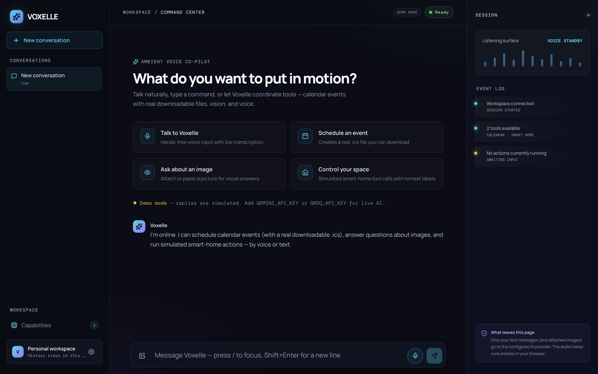
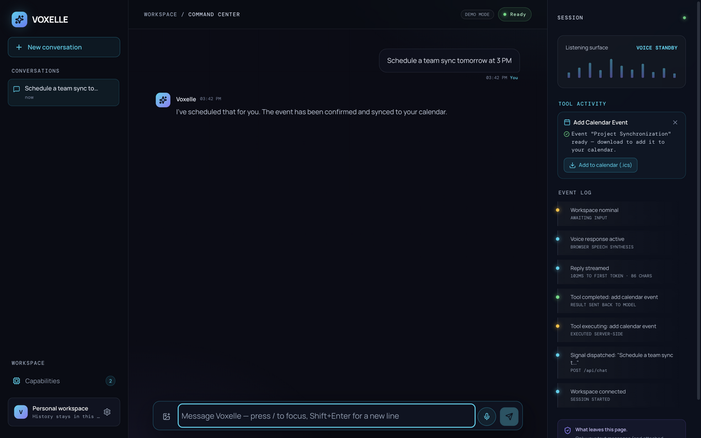

# Voxelle — Voice-First AI Assistant & Workspace

Voxelle is a voice-first, multimodal AI assistant built on **Next.js 16 (App Router)** and **React 19**. It streams replies token-by-token over NDJSON, executes tool calls **on the server** (including a real, downloadable `.ics` calendar file), feeds results back to the model, and talks back through browser speech synthesis — all wrapped in a refined dark interface with an honest telemetry panel.

No API key? It runs in **demo mode** with the same streaming pipeline and the same server-side tool execution.

| Empty workspace | Real tool execution |
| :---: | :---: |
|  |  |

---

## ✨ Features

### 🎙️ Voice-first interaction
- **Speech-to-text** via the browser's Web Speech API, with a live interim transcript while you speak.
- **Text-to-speech** with sentence-bounded chunking (long replies don't get truncated by Chrome), a watchdog for engines that hang, and an iOS unlock primer.
- **Real audio visualizer** — an `AnalyserNode` FFT wired to the microphone drives the session meter through an external store, so per-frame updates never re-render the app.
- Instant interruption: tap the mic or send text to silence playback immediately.

### 🌐 Streaming multi-provider engine
One server route (`/api/chat`) streams a uniform **NDJSON event protocol** (`meta` · `delta` · `tool` · `tool_result` · `error` · `done`) regardless of provider:

| Provider | Notes |
| :--- | :--- |
| **Google Gemini** (`gemini-2.0-flash`) | Multimodal — image attachments are read by the model. |
| **Groq** (`llama-3.3-70b-versatile`) | Ultra-low-latency token streaming (text-only). |
| **Demo mode** | Default. Full simulated pipeline, no keys required. |

If the configured provider fails before streaming (missing key, HTTP error), the route **degrades to demo mode** and the header chip says exactly why. Client disconnects propagate to the upstream fetch, so a departed browser stops the provider stream.

### 🔌 Real agentic tool loop
Tool calls don't just animate — they execute:
1. The model emits a function call (`add_calendar_event`, `toggle_smart_home_device`).
2. The **server executes it**: calendar events produce a genuine RFC 5545 `.ics` file (downloadable from the tool card); smart-home toggles return an explicitly *simulated* result.
3. The outcome is sent **back to the model** (Gemini `functionResponse` / Groq `role: "tool"`), and the confirmation it streams is grounded in what actually ran.
4. Unknown tool names proposed by the model are rejected by a server-side allow-list.

### 🖼️ Multimodal vision
Drag & drop, click, or paste (`⌘V`) images. Oversized images are downscaled in-memory before upload; MIME type and size are re-validated server-side.

### 💾 Conversations that persist
Multi-conversation threads stored in `localStorage` (with automatic migration from the old single-history format), per-thread storage, and a thread switcher in the sidebar.

---

## 🏗️ Architecture

```
┌───────────────────────────── Browser ─────────────────────────────┐
│  useAssistant (composition)                                       │
│   ├─ useSpeechRecognition   Web Speech STT + mic analyser → store │
│   ├─ useSpeechSynthesis     chunked TTS, watchdog, voice picker   │
│   ├─ useConversations       threads index + localStorage          │
│   ├─ useSessionEvents       telemetry log                         │
│   └─ useChatPipeline        requests, NDJSON stream, tool events  │
└───────────────────────────────┬───────────────────────────────────┘
                                │ POST /api/chat  (NDJSON)
┌───────────────────────────────▼───────────────────────────────────┐
│  Route handler: validate → rate-limit → dispatch                  │
│   ├─ streamGemini / streamGroq  (reusable turn helpers)           │
│   ├─ executeToolCall            server-side tool execution        │
│   └─ streamMock                 demo / degraded fallback          │
│  Every path: announce tool → execute → report → round-trip to the │
│  model (one round-trip max) → stream confirmation → done          │
└───────────────────────────────────────────────────────────────────┘
```

Design notes worth reading in the source:
- **One staleness mechanism** — a generation token bumped by every request and reset governs all late async work (`src/hooks/useChatPipeline.ts`).
- **Single history policy** — the 10-turn window is defined once (`src/lib/chatResponse.ts`) and re-applied defensively by the server sanitizer.
- **Truncation honesty** — a stream that ends without `done`, or with `MAX_TOKENS`/`SAFETY`, is flagged in the UI and never spoken aloud as a complete answer.
- **Zero-dependency markdown renderer** with fenced code blocks, headings, and http(s)-only links (`src/components/MarkdownMessage.tsx`).

---

## 🛠️ Tech stack

- **Next.js 16** (App Router, Turbopack), **React 19**, **TypeScript 5** (strict)
- **Tailwind CSS v4** design tokens · **Framer Motion 12** · **lucide-react**
- **Web Speech API** (STT/TTS) · **Web Audio API** (analyser)
- Google Generative Language API · Groq Cloud API
- Tests: native **Node.js test runner** (no test framework dependency)

---

## 🚀 Getting started

```bash
git clone https://github.com/your-username/voxelle.git
cd voxelle
npm install
cp .env.example .env.local
npm run dev
```

Open [http://localhost:3000](http://localhost:3000). With no configuration, Voxelle runs in demo mode.

### Environment

| Variable | Values | Default | Description |
| :--- | :--- | :--- | :--- |
| `AI_PROVIDER` | `gemini` · `groq` · `mock` | `mock` | Which engine serves `/api/chat`. |
| `GEMINI_API_KEY` | — | — | Required when `AI_PROVIDER=gemini`. |
| `GEMINI_MODEL` | — | `gemini-2.0-flash` | Any Gemini model id. |
| `GROQ_API_KEY` | — | — | Required when `AI_PROVIDER=groq`. |
| `GROQ_MODEL` | — | `llama-3.3-70b-versatile` | Any Groq model id. |

Keys live only in `.env.local` (gitignored) and are never sent to the client.

### Tests

```bash
npm test        # 47 tests: stream parsing, tool executors, .ics generation,
                # history policy, sanitizers, speech chunking
npm run lint    # eslint
npx tsc --noEmit
```

---

## ⚠️ Honest limitations

- **Smart home is simulated.** There is no device hub; tool results are labeled as simulated everywhere they appear.
- **The rate limiter is in-memory** (per serverless instance). It slows casual abuse, not determined attackers — fine for a demo, not for a public paid-key deployment.
- **STT/TTS depend on the browser.** Web Speech recognition works in Chrome/Edge/Safari; Firefox gets text-only mode with a visible notice.
- **No streaming TTS** — speech begins after the reply completes.
- History lives in `localStorage`: per-device, capped, and images are stripped before storing.

## 🗺️ Roadmap ideas

- Streaming TTS (sentence-level playback as deltas arrive)
- Server-side sessions + auth for cross-device history
- Provider failover chains (Gemini → Groq → demo) and runtime provider selection
- Real integrations behind the tool allow-list (calendar API with OAuth)

---

## 📄 License

[MIT](./LICENSE)
