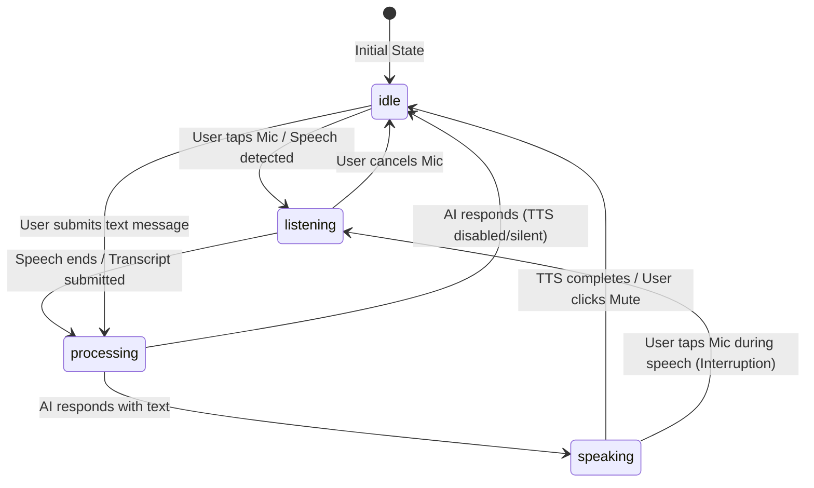

# 🌌 Voxelle — Comprehensive Project & Architecture Guide
**A Complete Blueprint: How to Present, Explain, and Understand How Voxelle Was Built**

---

## 📑 Table of Contents

- [Executive Summary](#executive-summary)
- [PART 1: How to Explain Voxelle to Another Person](#part-1-how-to-explain-voxelle-to-another-person)
  - [1.1 The Elevator Pitch (3 Levels)](#11-the-elevator-pitch-3-levels)
  - [1.2 The Problem Voxelle Solves](#12-the-problem-voxelle-solves)
  - [1.3 Mental Model & High-Level System Architecture](#13-mental-model--high-level-system-architecture)
  - [1.4 Step-by-Step Live Demo Script](#14-step-by-step-live-demo-script)
  - [1.5 Key Differentiators: Why This Project Stands Out](#15-key-differentiators-why-this-project-stands-out)
  - [1.6 Technical Interview Q&A Cheatsheet](#16-technical-interview-qa-cheatsheet)
- [PART 2: How Voxelle Was Built (Engineering Deep Dive)](#part-2-how-voxelle-was-built-engineering-deep-dive)
  - [2.1 Tech Stack & Foundational Choices](#21-tech-stack--foundational-choices)
  - [2.2 The Central Orchestration Brain (`useAssistant.ts`)](#22-the-central-orchestration-brain-useassistantts)
  - [2.3 Voice Engineering Pipeline (STT & TTS)](#23-voice-engineering-pipeline-stt--tts)
  - [2.4 Multi-Provider AI Engine & Function Calling (`/api/chat`)](#24-multi-provider-ai-engine--function-calling-apichat)
  - [2.5 Multimodal Vision Pipeline (`ImageDropzone.tsx`)](#25-multimodal-vision-pipeline-imagedropzonetsx)
  - [2.6 Frontend Architecture & Cyber-Dark UI Design](#26-frontend-architecture--cyber-dark-ui-design)
  - [2.7 Reliability, Resilience & Browser Support](#27-reliability-resilience--browser-support)
  - [2.8 Challenges Overcome, Trade-offs & Future Roadmap](#28-challenges-overcome-trade-offs--future-roadmap)

---

## Executive Summary

**Voxelle** is an ambient, voice-first multimodal AI assistant and workspace command center. It bridges the gap between conversational AI and real-world system automation. 

Unlike conventional chatbots that trap users in a synchronous text input/output loop, Voxelle enables fluid voice dialogues, executes real-time function calls (such as scheduling calendar events and toggling smart home appliances), analyzes visual inputs via multimodal vision reasoning, and visualizes live system telemetry across a 3-column cyber-dark dashboard.

Built on **Next.js 16 (App Router)** and **React 19**, styled with **Tailwind CSS v4** and animated via **Framer Motion 12**, Voxelle operates with zero required cloud dependencies in its demo mode, while seamlessly integrating with **Google Gemini 2.0 Flash** and **Groq (Llama 3.3 70B)** when API keys are provided.

---

# PART 1: How to Explain Voxelle to Another Person

When presenting Voxelle to recruiters, hiring managers, clients, or peer developers, you need to adjust your explanation based on your audience. Here is how to articulate the project with confidence.

---

### 1.1 The Elevator Pitch (3 Levels)

#### The 30-Second Non-Technical Pitch
> *"Voxelle is a voice-controlled personal co-pilot designed for fast, hands-free workspace productivity. Instead of typing into a chatbot, you simply speak to it. Voxelle understands what you say, answers with natural voice audio, inspects photos you drop onto the screen, and takes actions in the background—like adding meetings to your calendar or turning off office lights—displaying live status cards as it works."*

#### The 2-Minute Product & Architecture Pitch
> *"Most AI chat interfaces are passive text boxes: you type, you wait, you read text. Voxelle flips this into an ambient command center. It combines browser-native Web Speech recognition and synthesis with modern large language models.*
>
> *When you speak, Voxelle captures your voice client-side without costly third-party audio streaming APIs, automatically submits the final transcript to a Next.js server route, and dispatches it to either Google Gemini 2.0 Flash or Groq Llama 3.3. If the user asks to schedule a meeting or adjust a smart device, the model doesn't just reply—it outputs structured function calls. Voxelle's UI receives these calls, animates real-time execution cards in a telemetry activity rail, and executes the simulated or connected hardware actions while reading the natural voice confirmation aloud.*
>
> *It also supports multimodal vision: you can drag and drop an image or screenshot, and the assistant reasons over both your voice and the image simultaneously. It's built on React 19 and Next.js 16 with a cyberpunk glassmorphic aesthetic."*

#### The Deep Technical Pitch (Senior Engineers & Hiring Managers)
> *"Voxelle is a full-stack, voice-native multimodal AI orchestrator built on Next.js 16 (App Router) and React 19. It uses a custom-built finite state machine (`idle` ➔ `listening` ➔ `processing` ➔ `speaking`) to synchronize bidirectional audio streaming using the browser's Web Speech API (`SpeechRecognition` and `SpeechSynthesis`).*
>
> *On the backend, `/api/chat` implements an abstraction layer supporting multiple LLM providers: Google Gemini 2.0 Flash with inline base64 multimodal vision and Gemini tool declarations, Groq Cloud with OpenAI-compatible function calling, and a deterministic offline mock engine for zero-configuration testing.*
>
> *When an LLM emits function calls (`add_calendar_event` or `toggle_smart_home_device`), the client receives structured tool payloads, transitions them through a reactive lifecycle (`pending` ➔ `executing` ➔ `completed`) with simulated network latency, pushes audit telemetry to a live activity rail, and triggers voice synthesis with smart fallback voice selection. The design system leverages Tailwind CSS v4, custom HSL design tokens, and Framer Motion spring physics with zero hydration mismatches."*

---

### 1.2 The Problem Voxelle Solves

Standard AI interfaces (like vanilla ChatGPT or Claude Web) suffer from three fundamental limitations:
1. **High Interaction Friction**: Users must switch tabs, focus a text input, type out prompts, and visually read lengthy walls of text.
2. **Lack of Actionability**: Pure text models generate text suggestions, but cannot execute tasks or control tools in the user's workspace without custom integrations.
3. **No Ambient Awareness**: Desktop AI often lacks visual telemetry, real-time auditory feedback, or glanceable system status.

**How Voxelle Solves This:**
- **Zero-Friction Voice Loop**: Tap once or speak; speech recognition automatically detects the end of your sentence, stops listening, invokes the pipeline, and speaks the answer aloud.
- **Action-Oriented Tooling**: Integrates tool declarations directly into the LLM system prompt and function calling schema.
- **Command Center Telemetry**: A 3-column cyber interface displays live audio waveform bars, session audit logs, and tool execution status simultaneously.

---

### 1.3 Mental Model & High-Level System Architecture

Here is the mental model of how data travels through Voxelle:

```
+-----------------------------------------------------------------------------------+
|                                  USER BROWSER                                     |
|                                                                                   |
|  [Voice Mic]                [Drag & Drop Image]             [Keyboard Input]      |
|        |                             |                             |              |
|        v                             v                             |              |
|  useSpeechRecognition          FileReader (Base64)                 |              |
|   (Web Speech API)                   |                             |              |
|        |                             |                             |              |
|        +---------------------+-------+-----------------------------+              |
|                              |                                                    |
|                              v                                                    |
|                 useAssistant Central State Machine                                |
|            [idle] -> [listening] -> [processing] -> [speaking]                    |
|                              |                                                    |
+------------------------------|----------------------------------------------------+
                               | HTTP POST /api/chat (Messages + Image Data URI)
                               v
+-----------------------------------------------------------------------------------+
|                        NEXT.JS 16 SERVER-SIDE RUNTIME                             |
|                                                                                   |
|                          /api/chat/route.ts Router                                |
|                                      |                                            |
|              +-----------------------+-----------------------+                    |
|              |                       |                       |                    |
|      AI_PROVIDER=gemini      AI_PROVIDER=groq        AI_PROVIDER=mock             |
|              |                       |                       |                    |
|              v                       v                       v                    |
|       Google AI Studio          Groq Cloud              Deterministic             |
|      (Gemini 2.0 Flash)      (Llama 3.3 70B)             Mock Engine              |
|     - Multimodal Vision      - Fast Inference       - No API Key Needed           |
|     - Function Calling       - Tool Calling         - Keyword Matching            |
|              |                       |                       |                    |
|              +-----------------------+-----------------------+                    |
|                                      |                                            |
|                   Returns: { response, toolCalls?: [...] }                        |
+--------------------------------------|--------------------------------------------+
                                       | JSON Response
                                       v
+-----------------------------------------------------------------------------------+
|                                 CLIENT HYDRATION                                  |
|                                                                                   |
|    1. Update Messages Array ────> Hydrate Center ChatLog                          |
|    2. Trigger Tool Calls ───────> Push to Live Activity Rail (Pending->Completed) |
|    3. Push Telemetry Event ─────> Session Audit Stream                            |
|    4. Trigger Audio TTS ────────> useSpeechSynthesis (Speaks response aloud)      |
+-----------------------------------------------------------------------------------+
```

---

### 1.4 Step-by-Step Live Demo Script

When demonstrating Voxelle to someone live, follow this 4-step sequence to showcase the entire product capability in under 3 minutes:

#### Step 1: The Ambient Voice Loop
1. Click the glowing cyan microphone button (or press text suggestions like *"Plan my afternoon"*).
2. Say: *"Hey Voxelle, brief me on today."*
3. **Point out**:
   - The microphone pulses with concentric neon ripples during speech input.
   - The right Activity Rail's visualizer bars animate dynamically to sound.
   - Speech-to-Text automatically stops when you pause and sends the query.
   - Voxelle speaks the briefing back through high-fidelity Text-to-Speech while rendering the chat message.

#### Step 2: Intelligent Function Calling (Calendar Tool)
1. Speak or type: *"Schedule an architecture review meeting tomorrow at 3:00 PM."*
2. **Point out**:
   - Voxelle parses your intent and generates a structured tool call (`add_calendar_event`).
   - A purple shimmer progress card appears instantly in the Live Activity Rail.
   - The status updates from `Running` to `Completed` with a green badge.
   - Voxelle confirms vocally: *"I've scheduled 'architecture review meeting' for tomorrow at 3:00 PM."*

#### Step 3: Hardware & Smart Home Control
1. Speak or type: *"Turn off the living room lights."*
2. **Point out**:
   - The `toggle_smart_home_device` function executes.
   - The activity log registers a new cryptographic session event (`Tool completed: toggle smart home device`).
   - Demonstrates that Voxelle is an action engine, not just a chatbot.

#### Step 4: Multimodal Vision Reasoning
1. Click the `＋` button in the cyber composer to open the dropzone.
2. Drop in any image (a diagram, architecture screenshot, or photo).
3. Type or speak: *"What do you see in this image?"*
4. **Point out**:
   - The image is converted client-side into base64.
   - If configured with Gemini 2.0 Flash, it runs visual reasoning directly on the image parts and speaks the visual analysis aloud.

---

### 1.5 Key Differentiators: Why This Project Stands Out

When evaluating frontend and full-stack AI projects, engineers look for depth beyond simple wrappers. Here is why Voxelle stands out:

1. **Zero-Dependency Voice Architecture**:
   Rather than requiring expensive paid audio transcription APIs (e.g. OpenAI Whisper API, Deepgram, or ElevenLabs), Voxelle integrates the browser-native **Web Speech API**. This means zero audio upload latency, zero per-minute audio bills, and instant privacy.
2. **Pluggable Multi-LLM Provider System**:
   You can switch between Gemini 2.0 Flash, Groq Llama 3.3, and an offline mock engine simply by changing one environment variable (`AI_PROVIDER`).
3. **Frictionless Demo Mode**:
   Reviewers or recruiters can clone the repo and run `npm run dev` with **zero API keys** and experience the full application immediately.
4. **Resilient Finite State Machine**:
   Handles asynchronous edge cases like audio interruptions, permission denials, voice loading delays across browsers (Chrome, Safari, Edge), and rapid sequential inputs.
5. **Modern 2026 Tech Stack**:
   Uses Next.js 16 (App Router), React 19 hooks, and Tailwind CSS v4's unified `@theme` specification.

---

### 1.6 Technical Interview Q&A Cheatsheet

#### Q1: "Why did you use the Web Speech API instead of server-side Whisper or ElevenLabs?"
> **Answer:** *"For this application, interaction latency and ease of deployment were top priorities. Server-side audio processing requires streaming raw PCM audio or WebM chunks over WebSockets or HTTP, which introduces network roundtrips, encoding overhead, and infrastructure costs. The Web Speech API provides near-zero latency Speech-to-Text directly on the client's audio hardware and allows anyone to run the project locally without third-party audio service keys. However, the backend is architected so that replacing the voice layer with a WebSocket or WebRTC connection to Gemini Live or Whisper is a clean drop-in replacement."*

#### Q2: "How do you handle SSR hydration mismatches with browser-only APIs like SpeechRecognition and LocalStorage?"
> **Answer:** *"Web Speech and `localStorage` are only available on the `window` object in browser runtimes. In Next.js App Router, components pre-render on the server. If we accessed `window` directly during rendering, hydration would fail. We solved this in three ways: First, checking `typeof window === 'undefined'` in helper functions. Second, initializing state with safe defaults and hydrating from `localStorage` inside a `useEffect` hook with a `hydrated` flag. Third, adding `suppressHydrationWarning` on the HTML body to account for browser extensions injecting attributes."*

#### Q3: "How does function calling work between the client and the LLM?"
> **Answer:** *"We declare JSON function schemas in `src/app/api/chat/tools.ts`. For Gemini, these are passed into `tools.function_declarations`. For Groq, they are converted to OpenAI-compatible `tools: [{ type: 'function', function: { ... } }]`. When the model decides to invoke a tool instead of (or alongside) text, it emits function arguments. Our server extracts these into a standardized `ToolCall` interface (`id`, `name`, `arguments`, `status: 'pending'`). The frontend receives this array, queues them into the `toolEvents` state, transitions them through `executing` and `completed` states, renders visual cards, and synthesizes a vocal confirmation."*

#### Q4: "How does the multimodal vision pipeline work?"
> **Answer:** *"When a user drops an image into `ImageDropzone.tsx`, we use the browser's `FileReader.readAsDataURL` to encode the file into a base64 Data URI client-side. When the message is sent, the image payload travels alongside the text prompt in the POST body to `/api/chat`. In the Gemini handler, we parse the MIME type and raw base64 string using regex and inject it into the message payload as an `inline_data` part. Gemini 2.0 Flash processes the image and prompt in a single multimodal inference pass."*

---

# PART 2: How Voxelle Was Built (Engineering Deep Dive)

This section teaches you the internal architecture of every file, hook, component, and design decision in the repository.

---

### 2.1 Tech Stack & Foundational Choices

| Layer | Technology | Rationale |
| :--- | :--- | :--- |
| **Framework** | Next.js 16 (App Router) | High-performance React framework, unified API routes, optimal bundling, server-side environment variable security. |
| **UI Library** | React 19 | Concurrent features, modern hooks (`useCallback`, `useRef`, `useState`, `useEffect`), clean component trees. |
| **Styling** | Tailwind CSS v4 | Cutting-edge `@import "tailwindcss"` and `@theme inline` CSS variable definitions; no complex PostCSS config needed. |
| **Animations** | Framer Motion 12 | Fluid physics-based springs, SVG layout animations, `AnimatePresence` for exit animations on cards and modals. |
| **Voice STT/TTS**| Browser Web Speech API | Client-side native speech recognition and synthesis without external latency or cost. |
| **Vision Input**| `react-dropzone` | Accessible, drag-and-drop file ingestion with MIME validation and size limits (10MB). |
| **AI Backend** | Google Gemini 2.0 Flash + Groq Llama 3.3 | Multimodal reasoning, ultra-fast token generation, and native function calling. |

---

### 2.2 The Central Orchestration Brain (`useAssistant.ts`)

File: `src/hooks/useAssistant.ts`

`useAssistant` is the central nervous system of Voxelle. It coordinates audio inputs, API communication, tool lifecycles, and local state persistence.

#### The 4-State Finite State Machine
The assistant can only exist in one of four mutually exclusive states at any given moment:



#### Key Implementation Details:
1. **Ref Synchronization (`statusRef` & `processingRef`)**:
   React state updates are asynchronous. To prevent double submissions when speech recognition triggers rapid `onresult` and `onend` events, `processingRef.current` acts as an immediate synchronous lock:
   ```typescript
   if (processingRef.current) return;
   processingRef.current = true;
   ```
2. **LocalStorage Hydration**:
   Chat history (`voxelle_chat_history`) and recent signals (`voxelle_recent_signals`) are saved to `localStorage`. To avoid hydration mismatch errors in Next.js, loading occurs exclusively inside a client-side `useEffect`:
   ```typescript
   useEffect(() => {
     const stored = loadMessagesFromStorage();
     if (stored.length > 0) setMessages(stored);
     setHydrated(true);
   }, []);
   ```
3. **Tool Execution Lifecycle**:
   When the API returns `data.toolCalls`, `useAssistant` iterates over each tool, pushes it to `toolEvents` with status `'executing'`, delays for 1200ms to simulate environment dispatch, updates the status to `'completed'`, and records a system audit event in `sessionEvents`.

---

### 2.3 Voice Engineering Pipeline (STT & TTS)

#### Speech-to-Text: `src/hooks/useSpeechRecognition.ts`
This hook wraps the browser's `SpeechRecognition` (or `webkitSpeechRecognition` in Chrome/Safari):

- **TypeScript Global Extension**: Since Web Speech types are not in standard TypeScript DOM definitions, the hook declares interfaces for `SpeechRecognitionInstance`, `SpeechRecognitionEvent`, and `SpeechRecognitionErrorEvent`.
- **Auto-Triggering on Final Transcript**:
  ```typescript
  recognition.onresult = (event: SpeechRecognitionEvent) => {
    const result = event.results[event.results.length - 1];
    if (result.isFinal) {
      const finalTranscript = result[0].transcript.trim();
      setTranscript(finalTranscript);
    }
  };
  ```
- **Robust Error Categorization**:
  The `onerror` handler maps browser codes to human-readable error messages:
  - `not-allowed`: Informs the user that mic permission was denied.
  - `no-speech`: Gracefully handles silence without crashing.
  - `aborted`: Intentionally ignores user-initiated cancellations.

#### Text-to-Speech: `src/hooks/useSpeechSynthesis.ts`
This hook wraps `window.speechSynthesis`:

- **Voice Loading Race Condition**:
  Different browsers load voices asynchronously. Chrome fires a `voiceschanged` event, whereas Safari may populate `getVoices()` immediately. The hook listens to `voiceschanged` to ensure voices are always populated:
  ```typescript
  window.speechSynthesis.addEventListener('voiceschanged', updateVoices);
  ```
- **Intelligent Voice Selection**:
  Filters system voices to pick natural-sounding voices (e.g., Google Natural, Samantha, Daniel, Karen, Serena) before falling back to generic English engines.
- **Interruption Support**:
  Calling `stop()` or speaking a new utterance invokes `window.speechSynthesis.cancel()`, ensuring audio never overlaps.

---

### 2.4 Multi-Provider AI Engine & Function Calling (`/api/chat`)

Files: `src/app/api/chat/route.ts` & `src/app/api/chat/tools.ts`

The server-side endpoint `/api/chat` routes incoming messages to the active provider specified in `AI_PROVIDER`:

#### 1. Google Gemini 2.0 Flash Handler (`handleGemini`)
- **Multimodal Payload Inlining**:
  Extracts base64 image data and MIME types from the data URI:
  ```typescript
  const match = image.match(/^data:(.+);base64,(.+)$/);
  lastMsg.parts.push({
    inline_data: { mime_type: match[1], data: match[2] }
  });
  ```
- **Native Tool Declarations**:
  Passes `toolDefinitions` into `geminiBody.tools[0].function_declarations`.
- **Function Call Parsing**:
  Iterates over `candidate.content.parts`. If `part.functionCall` is found, constructs a standardized `ToolCall` object.

#### 2. Groq Cloud Handler (`handleGroq`)
- Uses `llama-3.3-70b-versatile` via the OpenAI-compatible endpoint `https://api.groq.com/openai/v1/chat/completions`.
- Transforms `toolDefinitions` into OpenAI's `{ type: 'function', function: { ... } }` schema.

#### 3. Offline Mock Engine (`handleMock`)
- Enables full offline demonstrations without an API key or internet access.
- Matches keywords against `mockScenarios` (e.g., `"plan my afternoon"`, `"brief me on today"`, `"lights"`, `"schedule"`, `"thermostat"`).
- Automatically emits mock tool calls and realistic confirmation strings.

#### The Tool Definitions Schema:
```typescript
export const toolDefinitions = [
  {
    name: 'add_calendar_event',
    description: 'Adds a new event to the user\'s calendar...',
    parameters: {
      type: 'OBJECT',
      properties: {
        title: { type: 'STRING', description: 'Event title' },
        time: { type: 'STRING', description: 'Time (e.g. "3:00 PM")' },
        date: { type: 'STRING', description: 'Date (e.g. "tomorrow")' },
      },
      required: ['title', 'time', 'date'],
    },
  },
  {
    name: 'toggle_smart_home_device',
    description: 'Turns a smart home device on or off...',
    parameters: {
      type: 'OBJECT',
      properties: {
        device_name: { type: 'STRING', description: 'Name of device' },
        state: { type: 'STRING', enum: ['on', 'off'], description: 'State' },
      },
      required: ['device_name', 'state'],
    },
  },
];
```

---

### 2.5 Multimodal Vision Pipeline (`ImageDropzone.tsx`)

File: `src/components/ImageDropzone.tsx`

1. **Drop Detection**: Uses `react-dropzone` with constraints:
   - Accept: `.png`, `.jpg`, `.jpeg`, `.gif`, `.webp`
   - Max file size: `10MB`
   - Max files: `1`
2. **Client-Side Encoding**:
   Uses `FileReader.readAsDataURL(file)` to generate a Base64 URI string without needing temporary server storage or S3 buckets.
3. **Preview & Dismissal**:
   Renders a compact glassmorphic thumbnail bar above the composer with an instant remove button (`✕`).
4. **Transit**:
   When the user submits a prompt, `uploadedImage` is passed to `processMessage(text, uploadedImage)` and cleared from state once dispatched.

---

### 2.6 Frontend Architecture & Cyber-Dark UI Design

Files: `src/app/globals.css`, `src/app/page.tsx`, `src/components/*`

#### The 3-Column Cyber Shell Layout
The grid system in `globals.css` dynamically organizes the workspace:
- **Left Column (`Sidebar.tsx`, 262px)**: Brand mark, new conversation trigger, workspace navigation (`Command center`, `Automations`, `Connected tools`), and recent signal prompts.
- **Center Column (`ChatLog.tsx`, minmax 500px, 1fr)**: Header with status badge, conversation thread, prompt suggestions, and the floating cyber composer.
- **Right Column (`ActivityRail.tsx`, 316px)**: Live audio equalizer meter, active tool execution cards, and real-time session audit telemetry.
- **Responsive Adaptability**: On tablet/mobile screens (`<1024px`), the layout collapses into a single column with slide-out overlay drawers.

#### Design Tokens & Theme System (`globals.css`)
Tailwind CSS v4 introduces CSS-first configuration:
```css
:root {
  --ink: #080b14;
  --surface: #0d1220;
  --surface-2: #111827;
  --line: rgba(163, 184, 218, 0.13);
  --muted: #8090aa;
  --text: #f0f5ff;
  --cyan: #35e6ff;
  --violet: #926cff;
  --lime: #b5f56f;
  --danger: #ff7594;
}
```

#### Audio Equalizer Animation
The Activity Rail contains 11 animated equalizer bars with staggered keyframe durations:
```css
.bar-anim-1 { animation: bar-pulse-1 1s ease-in-out infinite; }
.bar-anim-2 { animation: bar-pulse-2 0.8s ease-in-out infinite; }
/* ... staggered up to bar-anim-5 */
```
When `status === 'listening'` or `'speaking'`, the bars pulse dynamically; in `'idle'`, they gently rest at baseline heights.

---

### 2.7 Reliability, Resilience & Browser Support

File: `src/components/PermissionWarning.tsx`

Voxelle includes an automated diagnostic overlay:
- Detects whether `SpeechRecognition` is supported (recommends Chrome, Edge, or Safari).
- Detects whether `SpeechSynthesis` is available.
- Catches microphone permission denials and provides visual instructions for re-enabling access in browser site settings.

---

### 2.8 Challenges Overcome, Trade-offs & Future Roadmap

#### Challenges & Solutions
1. **Challenge: Accidental Loop Triggers in STT**
   *Problem*: Browser speech recognition could emit partial transcripts that re-trigger listening mode while the AI was already speaking, causing an acoustic feedback loop.
   *Solution*: Implemented `processingRef` locks and explicitly invoked `stopSpeaking()` before starting recognition, and vice versa.
2. **Challenge: Zero-Key First-Run Experience**
   *Problem*: Reviewers testing the repository without Google Cloud or Groq credentials would see API errors.
   *Solution*: Engineered a comprehensive Mock Scenario engine in `tools.ts` that activates by default if environment variables are omitted.
3. **Challenge: Cross-Browser TTS Inconsistencies**
   *Problem*: Chrome returns an empty array on the first `speechSynthesis.getVoices()` call until `voiceschanged` fires, while Safari doesn't always fire `voiceschanged`.
   *Solution*: Implemented a dual-check strategy that queries `getVoices()` immediately and registers the `voiceschanged` event listener.

#### Future Enhancements
- **WebRTC / Gemini Live Streaming**: Upgrading from turn-based HTTP POST to full duplex WebSockets / WebRTC for sub-500ms voice-to-voice streaming.
- **Local Whisper via WebAssembly**: Running Whisper.nano directly in the browser via ONNX Runtime Web for 100% offline private speech recognition.
- **Home Assistant WebSocket Integration**: Connecting the `toggle_smart_home_device` function to actual Home Assistant or Apple HomeKit local instances.

---

## 🏁 Summary Checklist for Presentations

When discussing Voxelle, remember these three core pillars:
1. **Voice-First Experience**: Web Speech API provides free, low-latency, client-side STT & TTS.
2. **Action-Oriented AI**: Native function calling (`add_calendar_event`, `toggle_smart_home_device`) transforms chat into concrete automation.
3. **Production Polish**: Cyber-dark glassmorphic design, React 19 / Next.js 16 architecture, multimodal vision, and offline demo fallback.
